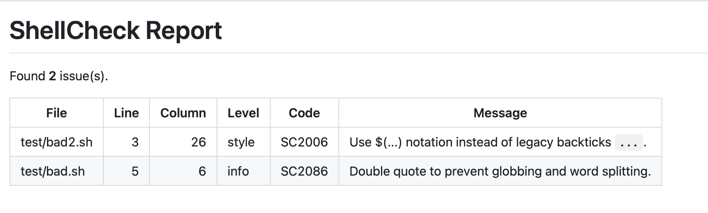

# ShellCheck Report

English | [简体中文](README.zh-CN.md)

Run ShellCheck and generate a report in the GitHub Actions Job Summary.

## Usage

ShellCheck Report Action performs static analysis and displays the results in a table.



- `path` (required): Files and directories to scan. Defaults to `**/*.sh`, which scans for shell files under the directory.
- `severity` (optional): Minimum severity level to report. Accepted values: `style`, `info`, `warning`, and `error`. Defaults to `style`.
- `exclude-issues` (optional): ShellCheck issues to exclude. Defaults to reporting all issues. Separate issue codes with commas, for example, `"SC2006,SC2105"`.
- `exclude-paths` (optional): Shell files to exclude from the ShellCheck scan.

### Example

```yaml
jobs:
  lint:
    runs-on: ubuntu-latest
    steps:
      - name: Checkout code
        uses: actions/checkout@v6
      - name: Run ShellCheck
        uses: Cai-Code/shellcheck-report-action@v1.0
        with:
          path: "test/**.sh"
          severity: style
          exclude-issues: "SC2006,SC1068"
          exclude-paths: "test/bad.sh"
