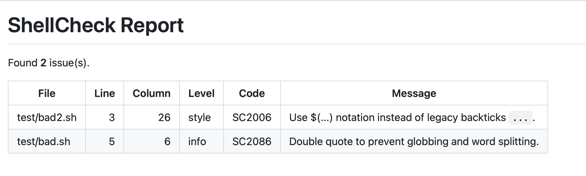

# ShellCheck Report Action

[English](README.md) | 简体中文

在 GitHub Actions 中运行 ShellCheck 并报告检查结果。

## 使用

ShellCheck Report Action 可以通过多种方式执行静态检查，结果以表格形式呈现。



- `path`， 必填，扫描特定的文件和目录，默认值: `**/*.sh`，扫描目录下所有的 shell 文件。
- `severity`，选填，指定要检查的最低错误级别，[style、info、warning、error]，默认值: `style`。
- `exclude-issues`, 选填，参数指定扫描期间要排除的 shellcheck 问题。默认值：扫描所有问题，问题号用逗号分隔，例如 "SC2006,SC2105"。
- `exclude-paths`，选填，从 shellcheck 扫描中排除指定 shell 文件。

### 示例
```yml
jobs:
  lint:
    runs-on: ubuntu-latest
    steps:
      - name: Checkout code
        uses: actions/checkout@v6
      - name: Run ShellCheck
        uses: Cai-Code/shellcheck-report-action@v1.0
        with:
          path: "test/**.sh"
          severity: style
          exclude-issues: "SC2006,SC1068"
          exclude-paths: "test/bad.sh"
```
